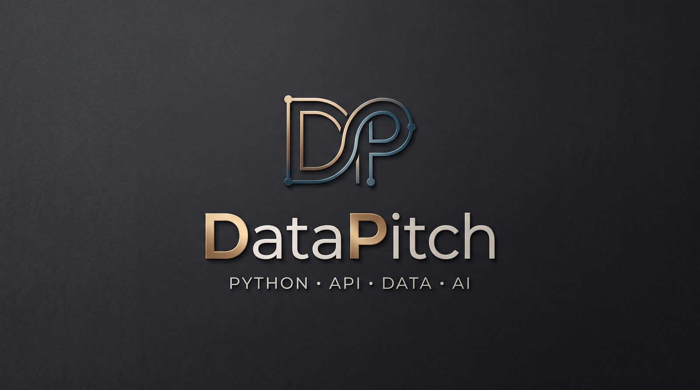

### Cześć, tu DataPitch 👋

Piszę w Pythonie narzędzia do analizy danych: integracje z API, raporty w Excelu i HTML,
modele statystyczne, backtesty, dashboardy i aplikacje z modelami językowymi (Claude API). Najbardziej lubię dane sportowe i rynkowe,
w których łatwo oszukać samego siebie, więc każdy projekt sprawdzam uczciwym testem.

*Python tools for data analysis: API integrations, Excel and HTML reports, statistical models,
honest backtests, dashboards and LLM apps.*

#### Projekty

| Projekt | Opis |
|---|---|
| 🧾 [**vat-whitelist**](https://github.com/datapitch-dev/vat-whitelist) | Hurtowa weryfikacja kontrahentów na białej liście VAT przez API Ministerstwa Finansów: setki NIP-ów w jednym poleceniu, sprawdzenie rachunków, elegancki raport Excel z identyfikatorem zapytania jako dowodem. |
| 🗺️ [**bdl-report**](https://github.com/datapitch-dev/bdl-report) | Raport dla dowolnej gminy lub powiatu z Banku Danych Lokalnych GUS: wykresy, porównanie z województwem i Polską, wykrywanie zmian metodologii, HTML i Excel gotowe do druku. |
| ⚽ [**footy-model**](https://github.com/datapitch-dev/footy-model) | Model Dixon-Coles dla 8 lig z backtestem walk-forward porównanym z kursami zamknięcia Pinnacle. Pokazuje, jak sprawdzić, czy model naprawdę bije rynek. |
| 📈 [**invest-radar**](https://github.com/datapitch-dev/invest-radar) | Codzienny radar sygnałów giełdowych (GPW i USA): analiza techniczna, newsy, transakcje insiderów, weryfikacja przez Claude, dashboard w Streamlit. |
| 🗣️ [**tex-talk**](https://github.com/datapitch-dev/tex-talk) | Partner do nauki angielskiego: rozmowa z postacią AI z Teksasu, poprawki błędów po polsku, zapisywane słówka, kontekst z prawdziwego świata. |

#### Na co dzień

Python · pandas · NumPy · SciPy · REST API · openpyxl · matplotlib · SQLite · Streamlit · Claude API · pytest · GitHub Actions

Szukasz kogoś do analizy danych, automatyzacji albo prototypu z AI? Napisz: datapitchhq@gmail.com
